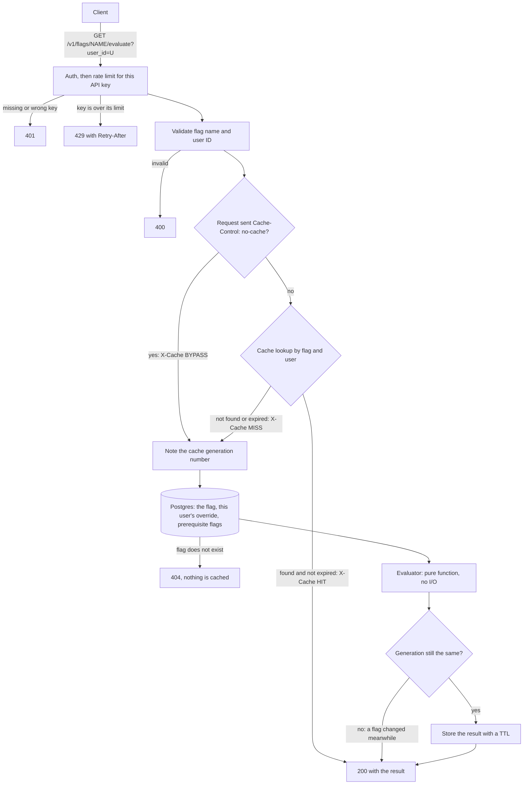
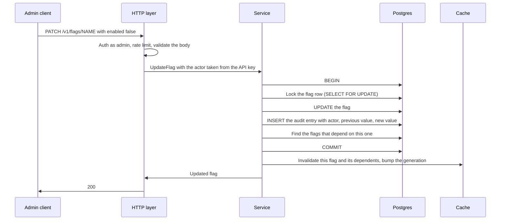

# Architecture

How a request moves through the service, and where the cache sits. The reasoning behind the choices is in [`discovery.md`](discovery.md); the rules are in [`../SPECS.md`](../SPECS.md).

## Components

One Go binary, one PostgreSQL database. The cache lives inside the binary.

| Layer | Package | Job |
|---|---|---|
| HTTP | `internal/httpapi` | Routing, auth, rate limiting, validation of the request shape, error to status code mapping |
| Service | `internal/service` | Orchestration: cache lookup, database read, evaluation, invalidation after writes |
| Domain | `internal/flag` | Flag types, validation rules, and the evaluator (a pure function) |
| Cache | `internal/cache` | In-process cache of evaluation results |
| Store | `internal/store` | PostgreSQL queries, transactions, migrations |

## Evaluation request path

`GET /v1/flags/{name}/evaluate?user_id=U`

### When the cache is consulted, bypassed, and invalidated

| Situation | What happens | `X-Cache` |
|---|---|---|
| Normal evaluation, result is cached and not expired | Answered from memory. No database query. | `HIT` |
| Normal evaluation, nothing cached or the entry expired | One database query, evaluate, store the result for the TTL (60 seconds by default). | `MISS` |
| Request carries `Cache-Control: no-cache` | The lookup is skipped. The fresh result replaces whatever was cached. | `BYPASS` |
| The flag does not exist | `404`. Nothing is stored, so a flag created a moment later is seen at once. | none |
| The request is invalid or not authenticated | Rejected before the cache is touched. | none |
| Any committed change to a flag | Every cached result for that flag, and for every flag that depends on it, is dropped. | next read is `MISS` |
| A change that changes nothing | No audit entry, no invalidation. | unaffected |

## Write path

Every change to a flag or an override follows the same steps. The example is disabling a flag.

Why it is built this way:

- **Change and audit entry share one transaction.** Either both are saved or neither is, so the audit trail cannot disagree with the data.
- **The row lock** makes two concurrent writers to the same flag run one after the other, so each audit entry records the true previous value.
- **Invalidation runs after the commit.** Invalidating earlier would let a concurrent read reload the old value from the database and cache it again.
- **The generation number** closes the remaining gap. A read that loaded old data just before the commit finishes after the invalidation; it sees that the generation moved and does not store its result.
- **Dependents are invalidated too.** If flag B requires flag A, turning A off changes B's answer, so B's cached results are dropped with A's.

## Known limits

- **One cache per instance.** With more than one instance, a write on one is seen by the others only when their entries expire (60 seconds at most). A shared cache such as Redis behind the same `Cache` interface removes this.
- **A very short stale window.** Between a write's commit and its invalidation (microseconds, same process) a concurrent evaluation can still be answered from the cache with the old value.
- **Expired entries are removed lazily.** There is no background sweep; an expired entry goes when it is read again, when its flag changes, or when the entry limit evicts it. A long-running instance with many one-time users therefore sits at the entry limit (100,000 by default), which bounds memory.
- **Eviction is arbitrary** when the limit is reached. It may drop a live entry while expired ones remain. The cost is one extra database query, never a wrong answer.
- **Rate limits are per instance** for the same reason as the cache.
