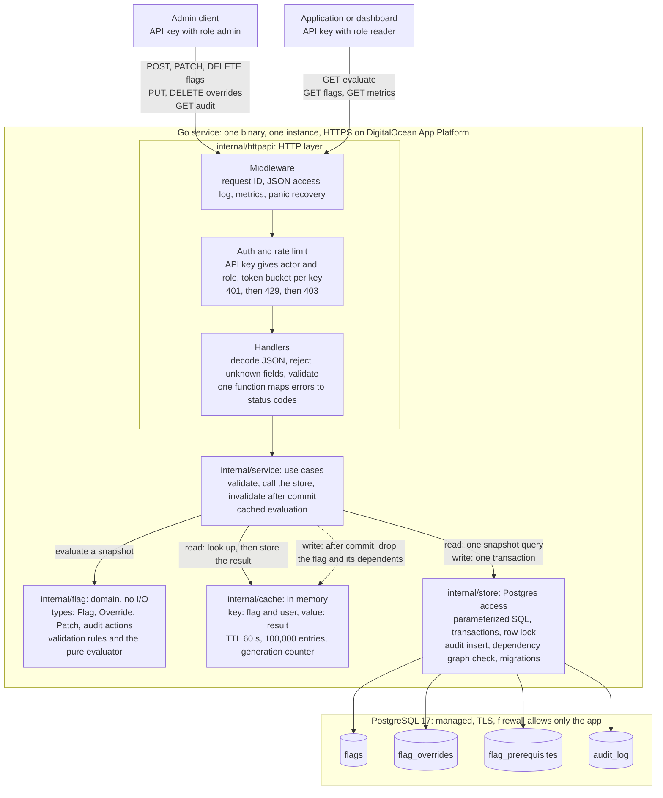
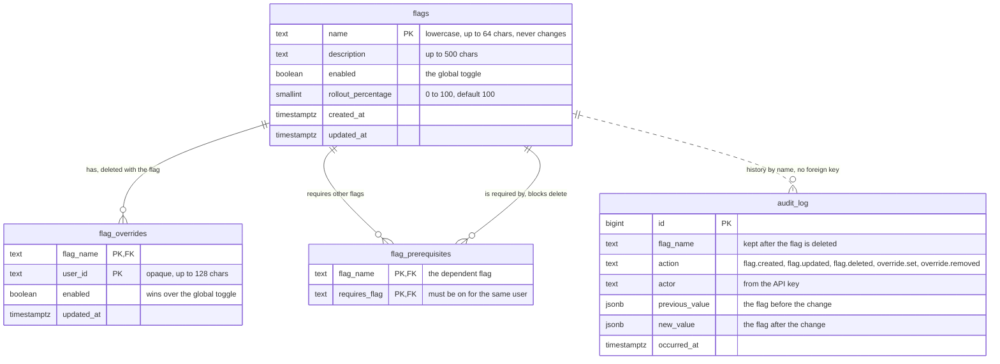
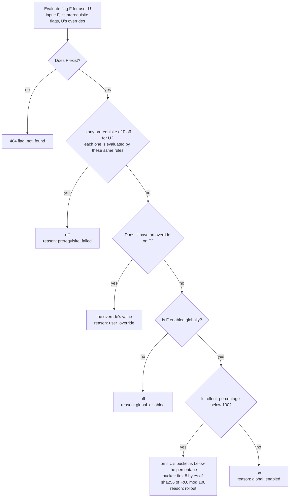
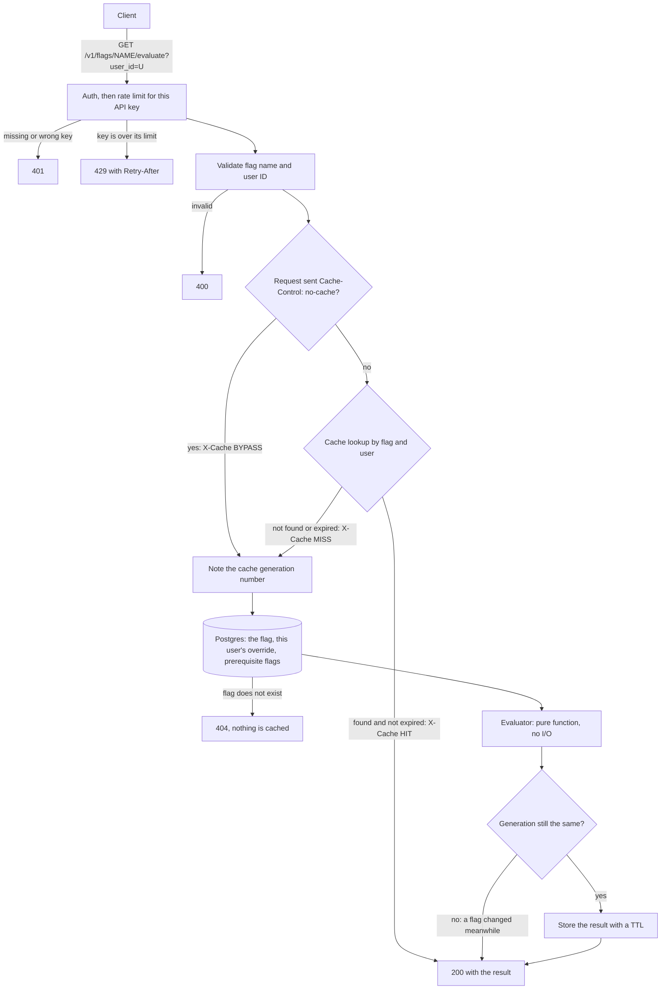
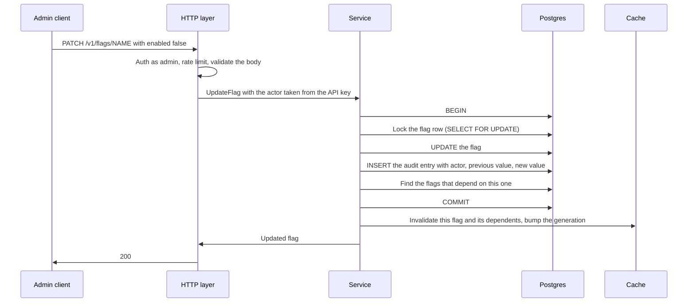

# Architecture

How a request moves through the service, and where the cache sits. The reasoning behind the choices is in [`discovery.md`](discovery.md); the rules are in [`../SPECS.md`](../SPECS.md).

The diagrams go from the whole system down to one request:

1. [System overview](#system-overview): every component and what it owns
2. [Data model](#data-model): the tables and how they relate
3. [Evaluation rules](#evaluation-rules): how one answer is decided
4. [Evaluation request path](#evaluation-request-path): where the cache sits on a read
5. [Write path](#write-path): transaction, audit entry, invalidation

## System overview

One Go binary, one PostgreSQL database. The cache lives inside the binary.

What is not in the picture because it needs no key and touches no flag: `GET /healthz` (the process is up) and `GET /readyz` (the database is reachable).

State lives in three places:

| State | Where | Lost on restart | Shared between instances |
|---|---|---|---|
| Flags, overrides, prerequisites, audit trail | PostgreSQL | No | Yes |
| Cached evaluation results | Process memory | Yes | No |
| API keys (hashed), rate limit buckets | Process memory, keys loaded from the environment | Buckets yes, keys reloaded | No |

## Components

| Layer | Package | Job |
|---|---|---|
| HTTP | `internal/httpapi` | Routing, auth, rate limiting, validation of the request shape, error to status code mapping |
| Service | `internal/service` | Orchestration: cache lookup, database read, evaluation, invalidation after writes |
| Domain | `internal/flag` | Flag types, validation rules, and the evaluator (a pure function) |
| Cache | `internal/cache` | In-process cache of evaluation results |
| Store | `internal/store` | PostgreSQL queries, transactions, migrations |

## Data model

Four tables. The schema is in [`0001_init.sql`](../internal/store/migrations/0001_init.sql) and [`0002_audit.sql`](../internal/store/migrations/0002_audit.sql).

| Table | Design choice | Reason |
|---|---|---|
| `flags` | The name is the primary key, and the database repeats the name, length, and range checks | No second identifier to keep in sync; bad data cannot get in even past the API |
| `flag_overrides` | One row per flag and user; `ON DELETE CASCADE` | Setting an override is an upsert; deleting a flag removes its overrides |
| `flag_prerequisites` | An edge list; `ON DELETE RESTRICT` on the required flag; index on `requires_flag` | A flag that others require cannot be deleted (`409`); the index finds dependents for cache invalidation |
| `audit_log` | Insert only; no foreign key; whole flag before and after as JSONB; index on `(flag_name, id DESC)` | History survives deletion; new flag fields need no schema change; "history of one flag, newest first" is one index scan |

There is no users table. A user ID is an opaque string sent by the caller; the service stores it only where a user has an override.

## Evaluation rules

The evaluator is a pure function in [`evaluate.go`](../internal/flag/evaluate.go). Its input is a snapshot: the flag, its prerequisite flags, and this user's overrides. The first rule that matches decides, and the response names it in `reason`.

- **Override beats the global toggle**: the override is checked before the global toggle, as the spec requires.
- **Prerequisites come first** and are a hard gate: an override cannot switch on a feature whose base is off.
- **The bucket is stable**: the same flag and user always give the same number, on any machine. Raising the percentage only adds users. The flag name is in the hash, so different flags select different users.

## Evaluation request path

`GET /v1/flags/{name}/evaluate?user_id=U`

### When the cache is consulted, bypassed, and invalidated

| Situation | What happens | `X-Cache` |
|---|---|---|
| Normal evaluation, result is cached and not expired | Answered from memory. No database query. | `HIT` |
| Normal evaluation, nothing cached or the entry expired | One database query, evaluate, store the result for the TTL (60 seconds by default). | `MISS` |
| Request carries `Cache-Control: no-cache` | The lookup is skipped. The fresh result replaces whatever was cached. | `BYPASS` |
| The flag does not exist | `404`. Nothing is stored, so a flag created a moment later is seen at once. | none |
| The request is invalid or not authenticated | Rejected before the cache is touched. | none |
| Any committed change to a flag | Every cached result for that flag, and for every flag that depends on it, is dropped. | next read is `MISS` |
| A change that changes nothing | No audit entry, no invalidation. | unaffected |

## Write path

Every change to a flag or an override follows the same steps. The example is disabling a flag.

Why it is built this way:

- **Change and audit entry share one transaction.** Either both are saved or neither is, so the audit trail cannot disagree with the data.
- **The row lock** makes two concurrent writers to the same flag run one after the other, so each audit entry records the true previous value.
- **Invalidation runs after the commit.** Invalidating earlier would let a concurrent read reload the old value from the database and cache it again.
- **The generation number** closes the remaining gap. A read that loaded old data just before the commit finishes after the invalidation; it sees that the generation moved and does not store its result.
- **Dependents are invalidated too.** If flag B requires flag A, turning A off changes B's answer, so B's cached results are dropped with A's.

## Known limits

- **One cache per instance.** With more than one instance, a write on one is seen by the others only when their entries expire (60 seconds at most). A shared cache such as Redis behind the same `Cache` interface removes this.
- **A very short stale window.** Between a write's commit and its invalidation (microseconds, same process) a concurrent evaluation can still be answered from the cache with the old value.
- **Expired entries are removed lazily.** There is no background sweep; an expired entry goes when it is read again, when its flag changes, or when the entry limit evicts it. A long-running instance with many one-time users therefore sits at the entry limit (100,000 by default), which bounds memory.
- **Eviction is arbitrary** when the limit is reached. It may drop a live entry while expired ones remain. The cost is one extra database query, never a wrong answer.
- **Rate limits are per instance** for the same reason as the cache.
