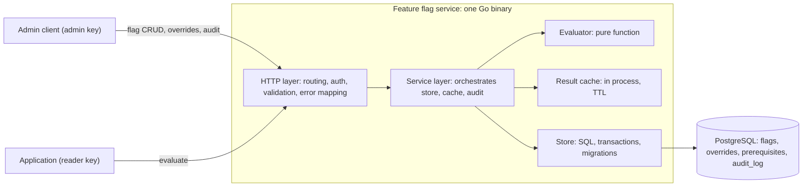
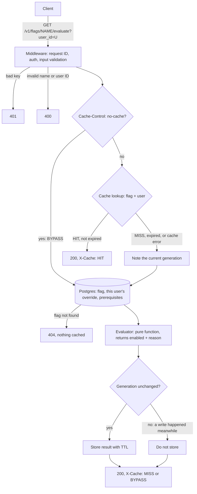
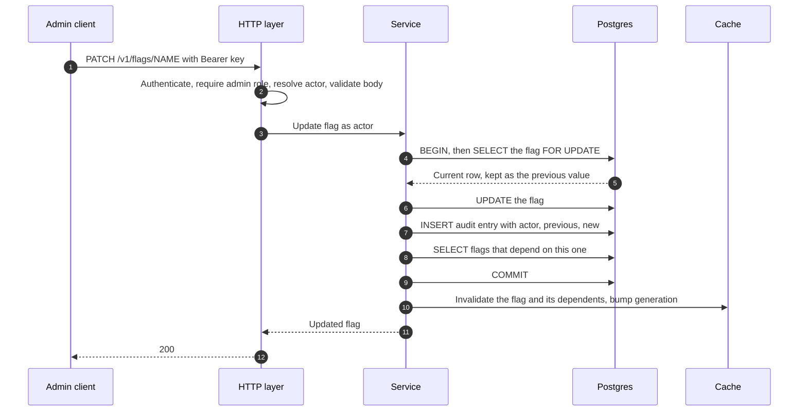
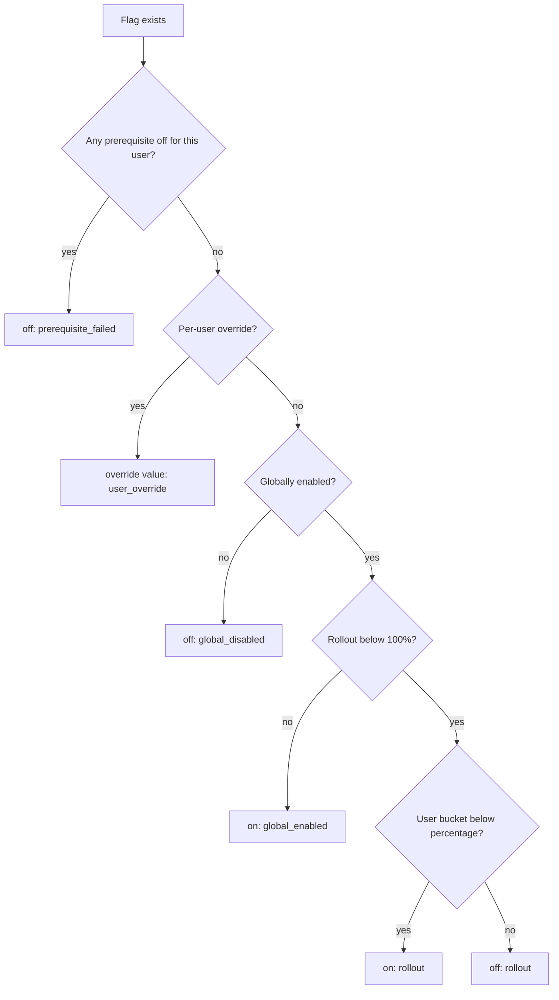
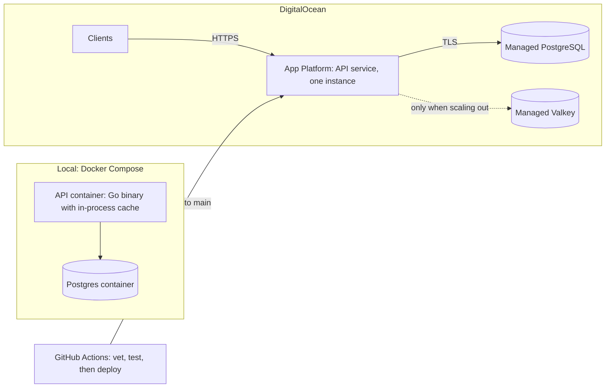

# Discovery: architecture, approaches, and trade-offs

Status: **Decisions accepted by the owner on 21 Nov 2026.** `SPECS.md` says what we are building; this document says how, and why this way rather than another.

The work is split into two stages:

- **Stage A (required scope):** a service that runs locally with `docker compose up` and meets every functional and engineering requirement.
- **Stage B (extensions):** percentage rollout, flag dependencies, and deployment to DigitalOcean.

## 1. Recommended design in brief

- One Go binary, layered into HTTP, service, evaluator, store, and cache packages.
- PostgreSQL is the source of truth. Every write runs in one transaction that also inserts the audit row.
- Evaluation is a pure function over data loaded from the store. It has no I/O, so it is unit-tested without a database.
- Evaluation results are cached in process per (flag, user). A write drops every cached result for the flag and for flags that depend on it; a TTL bounds anything that slips through.
- Bearer API keys from the environment identify the caller. The audit actor comes from the key, never from the request body.
- Locally, Docker Compose runs the API and Postgres. On DigitalOcean, App Platform runs the same image against Managed PostgreSQL.

## 2. Decisions

The owner accepted the recommendation for all seven questions below. Section 4 has the reasoning for each.

| # | Question | Recommendation | Main alternative | Section |
|---|---|---|---|---|
| D1 | Where is flag data stored? | PostgreSQL | SQLite file | 4.2 |
| D8 | What does the cache hold? | Evaluation results per (flag, user) | Flag snapshots per flag, evaluated on every request | 4.3 |
| D2 | Where does the cache live? | In process, behind an interface | Redis from the start | 4.4 |
| D3 | Who may call what? | Two key roles: `admin` (everything) and `reader` (read and evaluate) | One key type for everything | 4.6 |
| D4 | Prerequisite failed, but the user has an override of `true`? | Flag is off: prerequisites are a hard gate | Override wins | 4.8 |
| D9 | What do HTTP integration tests run against? | Real Postgres (Compose locally, service container in CI) | In-memory fake store | 4.10 |
| D7 | Which DigitalOcean product hosts it? | App Platform with Managed PostgreSQL | Droplet with Docker Compose | 8.3 |

D5 (standard-library HTTP stack) and D6 (flag name rules) in `SPECS.md` are low-risk defaults and are taken as proposed unless changed.

## 3. High-level design

### 3.1 Components

### 3.2 Code layout

| Path | Responsibility |
|---|---|
| `cmd/server` | Wiring: config, database pool, migrations, HTTP server, graceful shutdown |
| `internal/flag` | Domain types, validation rules, domain errors, the evaluator |
| `internal/store` | Postgres queries, transactions, embedded migrations |
| `internal/cache` | `Cache` interface and the in-process implementation |
| `internal/service` | Use cases: each write is store transaction, then cache invalidation |
| `internal/httpapi` | Routes, middleware (request ID, auth, body limit, recovery), JSON errors |
| `internal/config` | Environment parsing and startup validation |

Dependencies point inwards: `httpapi` knows `service`; `service` knows `flag`, `store`, and `cache`; `flag` knows nothing else.

## 4. Approaches and trade-offs

### 4.1 Service shape

| Option | For | Against |
|---|---|---|
| **One binary, layered packages** (preferred) | One thing to build, test, and deploy. Cache invalidation is a function call. | Management and evaluation scale together. |
| Separate management and evaluation services | Each scales and deploys alone; evaluation can be read-only. | Invalidation needs a message channel between them. Twice the deployment work. |

Preferred: one binary. The package boundaries keep a later split possible.

### 4.2 Storage (D1)

| Option | For | Against |
|---|---|---|
| **PostgreSQL** (preferred) | Transactions make "change plus audit row" atomic. Foreign keys protect overrides and prerequisites. Managed offering on DigitalOcean. | Needs a container locally and in CI. |
| SQLite | No server; a single file. | One writer at a time. The file is lost on platforms with ephemeral disks, such as App Platform. |
| In-memory maps | Fastest to write. | Data is lost on restart; not production-ready. |
| Redis as the primary store | Fast reads. | Weak fit for an audit trail and relational rules; durability depends on configuration. |

Preferred: PostgreSQL. Migrations are plain SQL files embedded in the binary and applied at startup under an advisory lock, so there is no separate migration tool to install.

### 4.3 What the cache holds (D8)

| Option | For | Against |
|---|---|---|
| **Evaluation results per (flag, user)** (preferred) | Matches the requirement as written ("evaluation results should be cached"). A hit does no database work and no evaluation. | Entries grow with flags times users, so the cache needs a size cap. Invalidation must also reach dependent flags. |
| Flag snapshots per flag (flag, all its overrides, prerequisites), evaluated on every request | Entries grow with flags only. Invalidation is one key. This is how LaunchDarkly-style systems work. | Does not cache results, which the requirement asks for. Holds every override in memory, which is poor for flags with very large override lists. |
| Both layers | Best hit rate. | Two invalidation paths to get right in the time available. |

Preferred: results per (flag, user), stored as a map of flags to a map of users, so one write drops a whole flag in a single step. Flag snapshots are the natural next step at larger scale (section 6).

### 4.4 Where the cache lives (D2)

| Option | For | Against |
|---|---|---|
| **In process, behind a `Cache` interface** (preferred) | No network hop, nothing extra to run, easy to test. Correct with one instance. | Each instance has its own cache. With several instances, a write is seen by the others only when the TTL expires. |
| Redis or Valkey from the start | One cache shared by all instances, so invalidation is immediate everywhere. | Another service to run, secure, test, and deploy. A network hop on every evaluation. A new failure mode to handle. |
| In process, with invalidations broadcast through Postgres `LISTEN/NOTIFY` | Keeps the fast local lookup and fixes multi-instance staleness without new infrastructure. | More code; needs a dedicated listening connection and reconnect handling. |

Preferred: in process now. The interface keeps the other two open as the scale-out path, and the deployment in stage B runs one instance, where this choice is fully correct.

### 4.5 Invalidation strategy

This is settled by 4.3 and 4.4 rather than a separate decision.

- **On write:** after the transaction commits, drop all cached results for the changed flag and for every flag that depends on it, directly or transitively. The dependents are found inside the same transaction.
- **TTL:** every entry expires (default 60 seconds, configurable). This bounds staleness if an invalidation is missed, and is the only cross-instance mechanism until a shared cache exists.
- **Stale write-back:** a read that loaded data just before a write could store its old result just after the invalidation. Each invalidation bumps a generation counter; a read stores its result only if the generation is unchanged since before it queried the database.
- **Size cap:** a configurable maximum number of entries, with eviction when full.
- **Not cached:** `404` responses, and any result computed while the cache is failing.

Alternatives rejected: TTL only (stale for up to a minute after a kill switch is pulled); clearing the whole cache on any write (simple and correct, but one write evicts every flag's results).

### 4.6 Authentication and audit actor (D3)

| Option | For | Against |
|---|---|---|
| **API keys with two roles** (preferred): `admin` may do everything, `reader` may read and evaluate | Applications that only evaluate cannot change flags. The actor name is bound to the key. | A few more lines of middleware and config. |
| One key type for all endpoints | Smallest. | Every evaluating application holds a key that can delete flags. |
| Evaluation open, writes authenticated | Easiest for clients. | Anyone can probe flag names and user overrides. |
| Actor from an `X-Actor` header | No key management. | The audit trail can be forged. |
| OAuth or JWT with user accounts | Real identities, expiry, revocation. | Far outside a three-hour scope. |

Preferred: keys with two roles, configured as `actor:role:token` entries in one environment variable. Several keys can be active at once, which allows rotation without downtime. The service refuses to start with no keys or with short tokens. Tokens are compared in constant time and never logged.

### 4.7 Audit trail

| Option | For | Against |
|---|---|---|
| **Row inserted in the same transaction as the change** (preferred) | The change and its audit entry commit or fail together. | The audit table grows in the primary database. |
| Written after the change, or asynchronously | Keeps the write path shorter. | A crash between the two leaves a change with no audit entry. |
| Database triggers | Cannot be skipped by application code. | The trigger does not know the API actor without extra plumbing; harder to test. |

Preferred: same transaction. The service locks the flag row, reads the previous value, applies the change, and inserts the entry with actor, time, action, previous value, and new value. Recorded actions: flag created, updated, deleted; override set and removed; prerequisite changes. The table is append-only: the API offers no way to edit or delete entries, and entries survive deletion of the flag.

### 4.8 Prerequisites versus overrides (D4)

| Option | Behaviour | Consequence |
|---|---|---|
| **Prerequisite is a hard gate** (preferred) | If a prerequisite is off for the user, the flag is off, whatever the override says. | A dependency means "this cannot work without that", so it is never bypassed by accident. To test early, override both flags for the user. |
| Override wins over everything | An override of `true` turns the flag on even when a prerequisite is off. | Simple to explain, but a single override can enable a feature whose foundation is disabled. |

Preferred: hard gate. It matches the wording of the requirement: the other flag must be enabled "before it evaluates to true".

### 4.9 Smaller API choices

| Choice | Decision | Reason |
|---|---|---|
| Evaluation endpoint | `GET /v1/flags/{name}/evaluate?user_id=U` | Read-only and idempotent. The service's access log records the path without the query string, so user IDs stay out of our logs. |
| Updates | `PATCH` with optional fields | Toggling a flag does not require resending the description. |
| Overrides | Sub-resource: `PUT` and `DELETE /v1/flags/{name}/overrides/{userID}` | Each change is atomic and gets its own audit entry. Replacing a whole list invites lost updates. |
| Flag read | Includes overrides and prerequisites | Meets "each flag has an optional per-user override list". |
| Errors | One JSON shape, mapped from domain errors in one place | A missing flag is always `404`; nothing leaks as `500`. |

### 4.10 Testing (D9)

| Option | For | Against |
|---|---|---|
| **HTTP integration tests against real Postgres** (preferred) | Exercises the real SQL, transactions, and constraints, which is where bugs hide. One store implementation. | Needs Docker locally; CI needs a Postgres service container. |
| In-memory fake store behind the store interface | `go test` works with nothing installed. | A second store to write and keep in step. The real SQL goes untested. |
| Testcontainers | Tests start their own database. | A heavy dependency and slower runs. |

Preferred: real Postgres. Evaluator and cache tests are pure unit tests and need nothing. Database-backed tests read `TEST_DATABASE_URL`; they skip when it is unset locally and fail when it is unset in CI, so CI cannot silently skip them.

## 5. Data flows

### 5.1 Evaluation (read path)

### 5.2 Flag change (write path)

If the transaction fails, nothing is written and the cache is left alone. If the process stops between steps 9 and 10, the in-process cache is gone with it; with a shared cache, the TTL covers that gap.

### 5.3 Evaluation order

## 6. Scale

| Concern | Stage A answer | Path beyond it |
|---|---|---|
| Evaluation latency | A hit is an in-memory map lookup. A miss is one or two indexed queries. | Flag-snapshot cache, so even first-time users need no query. |
| Cache memory | Entries grow with flags times active users. A hard cap on entries plus the TTL bounds memory. | Flag-snapshot cache grows with flags only. |
| Many instances | The API is stateless apart from the cache. Each instance's cache may be stale for up to the TTL after a write elsewhere. | Shared Redis or Valkey cache, or `LISTEN/NOTIFY` broadcast (4.4). |
| Burst of misses after an invalidation | Each miss is a cheap primary-key lookup, absorbed by the connection pool. | Collapse concurrent misses for the same key into one query. |
| Large override lists | Evaluation looks up one row by (flag, user); it never loads the whole list. | Paginate overrides in the flag read. |
| Audit growth | Indexed by flag and time; list endpoints take a bounded `limit`. | Partition by month, archive old entries to object storage. |
| Database load | Connection pool with a bounded size; every query has a context timeout. | Read replica for evaluation misses. |
| Abuse | Authentication on every `/v1` route; body and header size limits; server timeouts. | Rate limiting per key at the edge. |

The largest step change would be moving evaluation into client SDKs that hold flag data locally, as LaunchDarkly does. That is out of scope.

## 7. Security

| Threat | Mitigation |
|---|---|
| Unauthenticated or under-privileged changes | Every `/v1` route requires a key; writes require the `admin` role. |
| Forged audit entries | Actor comes from the authenticated key. The API cannot edit or delete audit entries. |
| Secrets leaking through the public repository | Configuration only from the environment; `.env` is ignored; staged diffs are checked before every commit. |
| Key theft through logs | Authorization headers, request bodies, and query strings are never logged. |
| Guessing keys by timing | Constant-time comparison over hashes of the tokens; minimum token length enforced at startup. |
| SQL injection | Parameterized queries only. |
| Oversized or slow requests | Body limit of 1 MB, header limit, read and write timeouts, strict JSON decoding that rejects unknown fields. |
| Malformed identifiers | Flag names and user IDs validated against strict patterns before reaching the database. |
| Dependency cycles causing endless evaluation | Cycles rejected at write time; depth limit at evaluation time. |
| Vulnerable dependencies | Minimal dependency set pinned by `go.sum`; `govulncheck` in CI. |
| Container compromise | Non-root user, minimal base image, no shell in the final image. |
| Traffic interception | HTTPS terminated by the platform in stage B; database connections require TLS. |
| Exposed database | Managed database reachable only by the app; no public listener locally beyond localhost. |
| Stale kill switch | A disabled flag takes effect on the writing instance immediately and elsewhere within the TTL. |

Known gaps, stated rather than hidden: no per-user accounts, no key expiry, no rate limiting, and keys live in environment variables rather than a secret manager.

## 8. Stage B: extensions

### 8.1 Percentage rollout

| Option | For | Against |
|---|---|---|
| **`sha256(flag + ":" + user)` reduced to a bucket from 0 to 99** (preferred) | Standard library, evenly spread, and stable across restarts and instances. Including the flag name gives each flag a different set of users. | Slower than a non-cryptographic hash, but negligible here and results are cached. |
| FNV or Murmur hash | Faster. | Weaker spread on short, similar IDs; Murmur needs a dependency. |
| Random choice stored per user | Exact percentages. | One row per user per flag; not derived from the user ID as required. |

A user is in the rollout when their bucket is below the percentage. Raising the percentage only adds users. `enabled = false` remains the kill switch whatever the percentage.

### 8.2 Flag dependencies

- Stored as rows of (flag, required flag), with a foreign key so a required flag cannot be deleted while something depends on it (`409`).
- Cycles are rejected when a dependency is written, by walking the graph inside the transaction (`409`).
- Evaluation loads the flag with its transitive prerequisites and the user's overrides for all of them, then the evaluator recurses over that snapshot with a depth limit.
- A change to a flag invalidates the cached results of every flag that depends on it (4.5).

### 8.3 Deployment on DigitalOcean (D7)

| Option | What it gives | What we must run ourselves | Fit |
|---|---|---|---|
| **App Platform with Managed PostgreSQL** (preferred) | Builds from the Dockerfile. HTTPS on a platform hostname, health checks, rolling deploys, logs, encrypted environment secrets. Database with backups and TLS. | Nothing beyond the app spec. | Best for the time available. |
| Droplet with Docker Compose | The same Compose file as local. Full control and the lowest cost. | Firewall, SSH hardening, patching, database backups, and TLS. Without a domain there is no certificate, so Bearer keys would travel over plain HTTP. | Fallback if App Platform is blocked. |
| Kubernetes (DOKS) | Scaling and rollout control. | Cluster, ingress, load balancer, and secrets. | Too heavy for one service. |
| Functions | No servers. | Not applicable. | Poor fit: the cache and connection pool need a long-lived process. |

Supporting products:

| Product | Use |
|---|---|
| Managed PostgreSQL | Source of truth. The smallest development database is enough. |
| Managed Valkey (Redis-compatible) | Only when running more than one instance (4.4). Not created in this exercise. |
| Container Registry | Not needed: App Platform builds from source. |
| Spaces | Not needed now; a later home for archived audit entries or database dumps. |
| Monitoring and uptime checks | Optional check against `/healthz`. |

Costs are a few dollars a month each for the smallest app instance and development database. Exact prices must be confirmed on the DigitalOcean pricing page before anything is created, and every resource is tagged and recorded in the deploy plan for teardown.

Delivery: GitHub Actions runs the tests on every push. Deployment after a green run is either App Platform's own deploy-on-push or a workflow step that calls `doctl` with a token held as a GitHub secret. The deploy plan picks one. The committed app spec contains no secret values.

### 8.4 Observability and monitoring

Added by the owner as a consideration. Nothing here is committed scope; the decision to implement is taken at the end.

Stage A already provides the base: structured JSON logs carrying a request ID, route, status, duration, and actor; `/healthz` and `/readyz`; and the `X-Cache` header on evaluations.

| Area | Options | Leaning |
|---|---|---|
| Application metrics | Prometheus-format `/metrics` endpoint; OpenTelemetry SDK exporting to a collector; standard-library `expvar` | Prometheus format: the most widely supported and one small dependency. It needs something to scrape it, which the plan must name. |
| Platform metrics | App Platform's built-in CPU, memory, and restart graphs with alert policies | Use as is; no code. |
| Uptime | DigitalOcean uptime check against `/healthz`, with an alert | Use as is; no code. |
| Logs | App Platform runtime logs; forwarding to an external log service for search and retention | Runtime logs now; forwarding only if retention matters. |
| Tracing | OpenTelemetry traces across HTTP and database calls | Skip: one service and one database gain little from tracing. |

Signals worth having:

| Signal | Why |
|---|---|
| Request rate, error rate, and latency per route | The basic health of the API. |
| Evaluations by reason code | Shows how flags are actually being decided. |
| Cache hits, misses, bypasses, entries, evictions, invalidations | Proves the cache works and shows when the size cap is too small. |
| Database pool in use and wait time | Early warning before evaluations slow down. |
| `401` and `403` counts | Key misuse or probing. |
| Readiness failures | The database is unreachable. |

Constraints if this is built: `/metrics` must not be public, and flag names and user IDs must never be metric labels, for both privacy and label-count reasons. DigitalOcean's exact monitoring features are to be confirmed in the plan before relying on them.

### 8.5 Rate limiting

Raised by the owner. The problem statement does not ask for it, so it is not needed for the required scope; it is a production-hardening extra, decided at the end.

What already limits abuse without it: every `/v1` route needs a key, bodies are capped at 1 MB, each request has a 5-second timeout, the database pool has a fixed size, and most evaluations are answered from the cache without touching the database.

What it would add: one misbehaving client (a retry loop, or constant `Cache-Control: no-cache`) could no longer take most of the database pool from everyone else.

| Option | For | Against |
|---|---|---|
| **In-process token bucket per API key** (leaning, if built) | About 50 lines with the standard library. Answers `429` with `Retry-After`. Fair between clients. | Limits are per instance, the same caveat as the in-process cache. |
| At the edge (a proxy or CDN in front of the service) | Stops traffic before it reaches the app; one limit across instances. | Another component to set up and pay for. |
| Shared limiter in Redis or Valkey | Exact limits across instances. | Needs the shared cache we chose not to run yet. |

Slowing down key guessing is not a reason to add it: tokens must be at least 32 characters and are meant to be randomly generated (`make env` does this), which puts them far beyond guessing range.

## 9. Phase plan

Every phase starts with a plan in `plans/` that is approved before work begins.

| Stage | Phase | Scope | Done when | Budget |
|---|---|---|---|---|
| A | 1. Core service | Module setup, domain and validation, evaluator with unit tests, Postgres store and migrations, flag CRUD, overrides, evaluation endpoint (uncached), auth, error mapping, Docker Compose | `docker compose up` serves the API; evaluator tests pass; a missing flag returns `404` | 35 min |
| A | 2. Cache and audit | In-process cache, invalidation with generation check, `X-Cache` header, audit rows in the write transaction, audit endpoints | A second evaluation is a `HIT`; a write turns the next one into a `MISS`; every change has an audit entry | 20 min |
| A | 3. Quality and docs | HTTP integration tests, GitHub Actions, Dockerfile hardening, README, final architecture diagram | CI is green on push; README covers setup, rules, and caching | 20 min |
| B | 4. Extensions | Rollout percentage and prerequisites exposed through the API, with tests | Rollout is deterministic; cycles are rejected; dependents are invalidated | 20 min |
| B | 5. Deployment | App spec, managed database, secrets, deploy, smoke test, teardown notes | The public URL answers `/healthz` and an authenticated evaluation | 15 min |
| B | 6. Observability and rate limiting (optional) | Metrics endpoint, uptime check, alerts (8.4); per-key rate limit (8.5) | Cache hit ratio and request latency are visible; excess requests get `429` | only if time remains |

The schema and the evaluator include rollout and prerequisites from phase 1, so phase 4 adds endpoints and tests rather than reshaping the core. Phase 6 is attempted only if time remains; before that, if time runs short, phase 5 is dropped first.

## 10. Risks and open points

| Risk | Effect | Response |
|---|---|---|
| DigitalOcean account status is `warning` | Resource creation may be refused. | Check the console before phase 5; if blocked, document the deployment instead. |
| Time | Extensions squeeze the required scope. | Stage A is finished and pushed before stage B starts. |
| In-process cache with several instances | Up to one TTL of staleness after a write. | Deploy one instance; state the limit in the README; shared cache as the next step. |
| Result cache growth | Memory pressure with many users. | Entry cap and TTL from the start. |
| App Platform access to the repository | Deploy-on-push needs the DigitalOcean GitHub app authorised in a browser. | Fall back to a public Git source and a `doctl` deploy step. |
