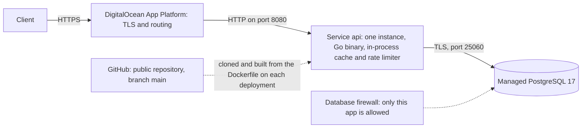

# Live walkthrough

The deployed service, what it runs on, and a set of `curl` and `doctl` commands against it. Every command and output below was run on 21 Nov 2026; IDs and timestamps will differ on your run.

**URL:** https://feature-flag-service-ey3u3.ondigitalocean.app

For the same steps on one machine, see [`local-walkthrough.md`](local-walkthrough.md). How the deployment was done, and what went wrong on the way, is in [`../plans/05-deploy-digitalocean.md`](../plans/05-deploy-digitalocean.md).

## What is deployed



| Piece | Detail |
|---|---|
| App | App Platform app `feature-flag-service`, ID `3e841b51-914a-4734-ad87-5f76fc8b0f84`, region Bangalore (`blr`) |
| Service | `api`, one instance of `apps-s-1vcpu-0.5gb` (1 shared CPU, 512 MB), built from the repository's `Dockerfile` |
| Database | Managed PostgreSQL 17 `feature-flag-service-db`, ID `6d559eb0-343e-46e8-8cd9-34820051aac1`, one node `db-s-1vcpu-1gb`, region `blr1`, tagged `feature-flag-service` |
| Network | HTTPS terminates at App Platform. The database accepts connections only from this app and only over TLS. |
| Secrets | `DATABASE_URL` and `API_KEYS` are stored encrypted by App Platform. Neither is in the repository. |
| Health check | App Platform probes `GET /healthz` |
| Alerts | Failed deployment, more than 3 restarts in 5 minutes, CPU or memory above 80% for 5 minutes |
| Schema | Created by the service at startup (embedded migrations, under an advisory lock) |
| Spec | [`../deploy/app.yaml`](../deploy/app.yaml) |
| Cost | About $20 a month (database about $15, app about $5) until deleted |

The same image and the same code path run locally and here. The differences are configuration only: where the database is, and which API keys exist.

## 0. Keys

The production API keys are in `.env.production` on the machine that deployed (ignored by git). Load them without printing them:

```sh
L=https://feature-flag-service-ey3u3.ondigitalocean.app
ADMIN=$(grep '^API_KEYS=' .env.production | cut -d= -f2 | tr ',' '\n' | awk -F: '$2=="admin"{print $3}')
READER=$(grep '^API_KEYS=' .env.production | cut -d= -f2 | tr ',' '\n' | awk -F: '$2=="reader"{print $3}')
J='Content-Type: application/json'
```

## 1. Health, and the door is locked

These three need no key and work from anywhere:

```sh
curl -s $L/healthz
curl -s $L/readyz
curl -s -o /dev/null -w 'no key: %{http_code}\n' $L/v1/flags
```

```
{"status":"ok"}
{"status":"ready"}
no key: 401
```

`/readyz` answering `ready` means the service reached the managed database through the firewall.

## 2. List flags

```sh
curl -s $L/v1/flags -H "Authorization: Bearer $READER" | jq -c '.flags[] | {name, enabled, rollout_percentage}'
```

```json
{"name":"welcome-banner","enabled":true,"rollout_percentage":100}
```

`welcome-banner` is an example flag left on the service.

## 3. Create a flag and evaluate it

```sh
curl -s -X POST $L/v1/flags -H "Authorization: Bearer $ADMIN" -H "$J" \
  -d '{"name":"live-demo","description":"Walkthrough flag","enabled":false}' | jq -c '{name, enabled, rollout_percentage, prerequisites}'

curl -si "$L/v1/flags/live-demo/evaluate?user_id=user-42" -H "Authorization: Bearer $READER" | grep -i -E '^HTTP|x-cache|x-request-id|^\{'
curl -si "$L/v1/flags/live-demo/evaluate?user_id=user-42" -H "Authorization: Bearer $READER" | grep -i x-cache
```

```
{"name":"live-demo","enabled":false,"rollout_percentage":100,"prerequisites":[]}
HTTP/2 200
x-cache: MISS
x-request-id: de443b37980612dc94fc58fc
{"flag":"live-demo","user_id":"user-42","enabled":false,"reason":"global_disabled"}
x-cache: HIT
```

## 4. Per-user override

```sh
curl -s -X PUT $L/v1/flags/live-demo/overrides/user-42 -H "Authorization: Bearer $ADMIN" -H "$J" -d '{"enabled":true}' | jq -c '{user_id, enabled}'
curl -si "$L/v1/flags/live-demo/evaluate?user_id=user-42" -H "Authorization: Bearer $READER" | grep -i -E 'x-cache|^\{'
```

```
{"user_id":"user-42","enabled":true}
x-cache: MISS
{"flag":"live-demo","user_id":"user-42","enabled":true,"reason":"user_override"}
```

The cached "off" from step 3 was invalidated by the override.

## 5. Enable for half of the users

```sh
curl -s -X PATCH $L/v1/flags/live-demo -H "Authorization: Bearer $ADMIN" -H "$J" -d '{"enabled":true,"rollout_percentage":50}' | jq -c '{name, enabled, rollout_percentage}'

for i in 1 2 3 4 5 6; do
  curl -s "$L/v1/flags/live-demo/evaluate?user_id=user-$i" -H "Authorization: Bearer $READER" | jq -r '"\(.user_id) \(.enabled) \(.reason)"'
done
```

```
{"name":"live-demo","enabled":true,"rollout_percentage":50}
user-1 true rollout
user-2 true rollout
user-3 true rollout
user-4 true rollout
user-5 false rollout
user-6 true rollout
```

Five of six is not half, and that is expected with so few users: each user lands in one of 100 buckets by hash, so the share approaches 50% only over many users (94 of 200 in the local test). The answers are stable: the same users are on every time.

## 6. Errors

```sh
curl -s "$L/v1/flags/does-not-exist/evaluate?user_id=user-42" -H "Authorization: Bearer $READER"
curl -s -o /dev/null -w 'reader key on a write: %{http_code}\n' -X DELETE $L/v1/flags/live-demo -H "Authorization: Bearer $READER"
```

```
{"error":{"code":"flag_not_found","message":"flag not found"}}
reader key on a write: 403
```

## 7. Audit trail

```sh
curl -s $L/v1/flags/live-demo/audit -H "Authorization: Bearer $ADMIN" | jq -r '.entries[] | "\(.id)  \(.action)  by \(.actor)"'
```

```
6  flag.updated  by prod-admin
5  override.set  by prod-admin
4  flag.created  by prod-admin
```

The actor is the name bound to the production admin key.

## 8. Metrics

```sh
curl -s $L/metrics -H "Authorization: Bearer $READER" | grep -E 'evaluate|cache' | grep -v '^#'
```

```
http_requests_total{route="GET /v1/flags/{name}/evaluate",status="200"} 10
http_requests_total{route="GET /v1/flags/{name}/evaluate",status="404"} 1
http_request_duration_seconds_sum{route="GET /v1/flags/{name}/evaluate"} 0.056512622
http_request_duration_seconds_count{route="GET /v1/flags/{name}/evaluate"} 11
evaluation_cache_results_total{result="hit"} 1
evaluation_cache_results_total{result="miss"} 9
evaluation_cache_results_total{result="bypass"} 0
evaluation_cache_entries 7
```

Eleven evaluations took 0.0565 seconds in total inside the service, about 5 ms each on average, and most of those were cache misses that queried the database.

## 9. Clean up

```sh
curl -s -o /dev/null -w '%{http_code}\n' -X DELETE $L/v1/flags/live-demo -H "Authorization: Bearer $ADMIN"
```

```
204
```

## 10. Looking at the platform with `doctl`

```sh
APP=3e841b51-914a-4734-ad87-5f76fc8b0f84
DB=6d559eb0-343e-46e8-8cd9-34820051aac1
```

**Deployments.** The newest is the active one.

```sh
doctl apps list-deployments $APP --format ID,Phase,Cause
```

```
ID                                      Phase         Cause
e83922d6-5b18-4b75-94d6-c1ff69f112ea    ACTIVE        restarting app
d3588e10-1cd7-4ebf-8a3d-71628217ba89    SUPERSEDED    restarting app
30eeb060-9198-4a4d-acb3-0ee190a6b7ed    SUPERSEDED    app spec updated
6bec651d-3413-41be-a22a-4cf5d1f13320    ERROR         initial deployment
```

The first deployment failed (a masked database password; see plan 05). The two restarts were done on purpose, to prove that a fresh process can connect through the database firewall.

**Logs.** The same JSON lines as locally:

```sh
doctl apps logs $APP --type run --tail 3
```

```
api 2026-11-21T09:24:01.635509078Z {"time":"2026-11-21T09:24:01.635359526Z","level":"INFO","msg":"request","request_id":"a9a604beef71fb5753130fcd","method":"GET","route":"GET /v1/flags/{name}/audit","status":200,"duration_ms":13,"actor":"prod-admin"}
api 2026-11-21T09:24:01.827256684Z {"time":"2026-11-21T09:24:01.827105268Z","level":"INFO","msg":"flag deleted","flag":"live-demo","actor":"prod-admin"}
api 2026-11-21T09:24:01.827288009Z {"time":"2026-11-21T09:24:01.827169305Z","level":"INFO","msg":"request","request_id":"f7139b9db56c37f592310b9f","method":"DELETE","route":"DELETE /v1/flags/{name}","status":204,"duration_ms":14,"actor":"prod-admin"}
```

**Database.**

```sh
doctl databases get $DB --format Name,Engine,Version,Region,Size,Status
```

```
Name                       Engine    Version    Region    Size              Status
feature-flag-service-db    pg        17         blr1      db-s-1vcpu-1gb    online
```

**Database firewall.** One rule: the app.

```sh
doctl databases firewalls list $DB
```

The output has one row, with type `app` and value `3e841b51-914a-4734-ad87-5f76fc8b0f84`. A connection attempt from the deploying machine, with the correct password, worked before the rule was added and timed out after it.

**Secrets are stored encrypted.** The spec as DigitalOcean holds it shows ciphertext, not values:

```sh
doctl apps spec get $APP | grep -A3 -E 'key: (DATABASE_URL|API_KEYS)'
```

Each of the two has `type: SECRET` and a `value` that starts with `EV[1:`.

## Operating it

| Task | Command |
|---|---|
| Deploy the current `main` | `doctl apps create-deployment $APP` (a push does not deploy by itself) |
| Restart without rebuilding | `doctl apps restart $APP` |
| Follow the logs | `doctl apps logs $APP --type run --follow` |
| Build logs of a deployment | `doctl apps logs $APP --deployment <id> --type build` |
| Delete everything | `doctl apps delete $APP --force` and `doctl databases delete $DB --force` |

## What cannot be shown here

- **Rate limiting.** The limit is 100 requests a second per key with bursts of 200, which `curl` in a loop does not reach. The local walkthrough lowers it to demonstrate `429`.
- **Several instances.** There is one, by design: the cache and the rate limiter are per process. See [`next-steps.md`](next-steps.md).
